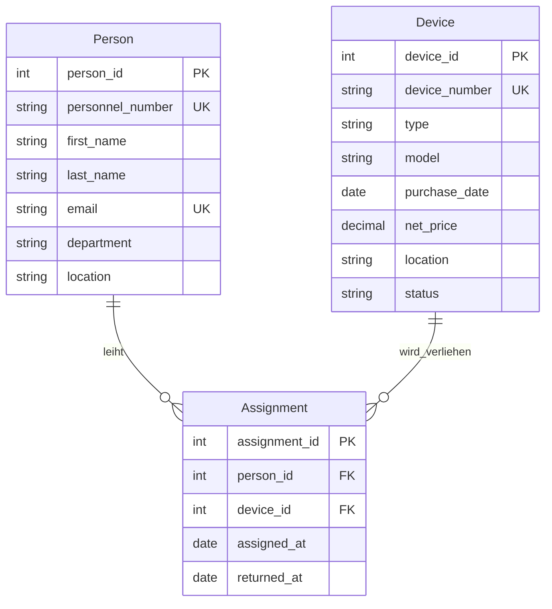

# Domänenmodell Inventar

## Regeln

- R1: Ein Gerät darf max. eine aktive Zuweisung haben (`returned_at` ist leer).
- R2: Zuweisungen desselben Geräts dürfen sich zeitlich nicht überschneiden.
- R3: `returned_at` darf nicht vor `assigned_at` liegen.
- R4: Ein Gerät darf erst nach dem Kaufdatum verliehen werden.

## UK/Constraint-Ideen

- UK auf `personnel_number`, `email` und `inventory_number`
- `status` nur mit festen Werten erlauben, z. B. `CHECK (status IN ('in_betrieb','defekt','ausgemustert'))`
- `CHECK (net_price > 0)`
- FKs `NOT NULL` und `ON DELETE RESTRICT`
